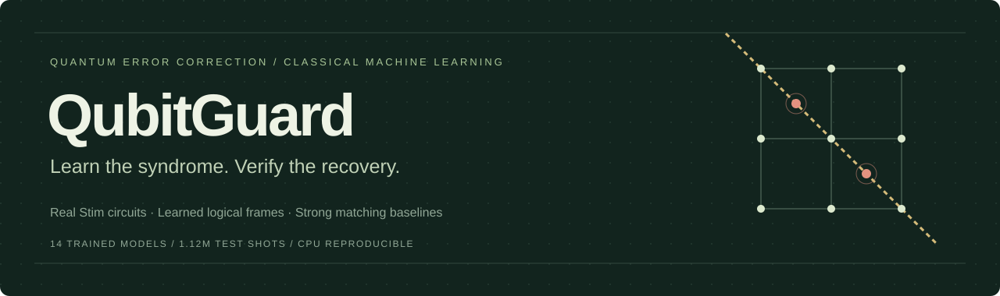
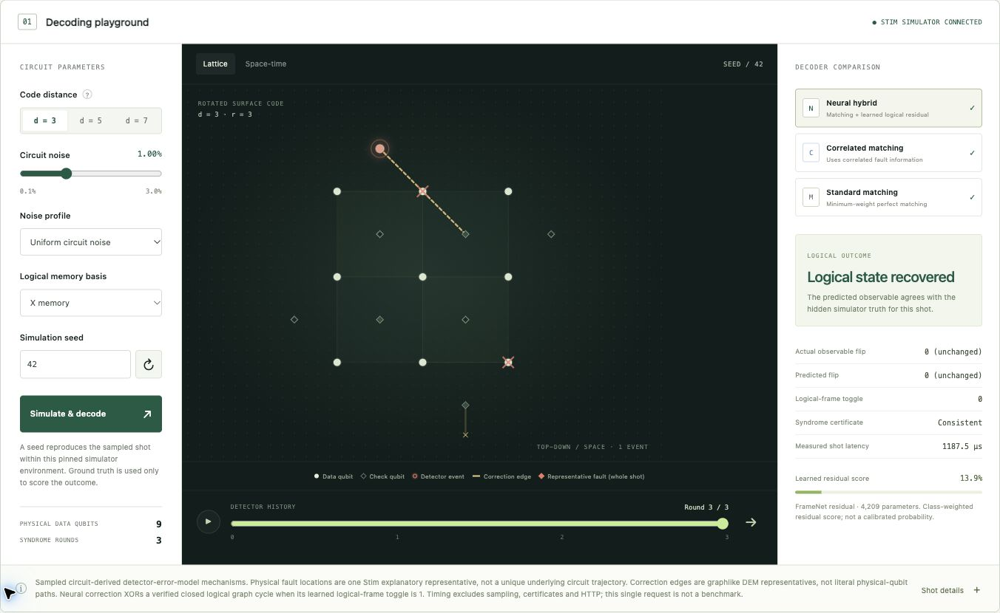
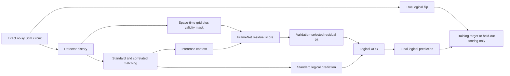

<p align="center">
  
</p>

<p align="center">
  <a href="https://github.com/nazeeh111/QubitGuard/actions/workflows/tests.yml"></a>
  <a href="https://github.com/nazeeh111/QubitGuard/releases"></a>
  <a href="LICENSE"></a>
  
</p>

<p align="center">
  <a href="#run-the-playground">Quick start</a> ·
  <a href="docs/technical-report.pdf">Technical report</a> ·
  <a href="docs/results.md">Results at a glance</a> ·
  <a href="docs/research-foundations.md">Research foundations</a> ·
  <a href="https://github.com/nazeeh111/QubitGuard/releases/latest">Download release</a>
</p>

# QubitGuard

**A reproducible CPU-scale laboratory for learned surface-code decoding.**

QubitGuard generates noisy quantum error-correction circuits with Stim, trains
an original compact PyTorch logical-frame model, and compares it with standard
and correlated PyMatching on identical independent test shots. The interactive
playground runs the real simulator and shows detector histories, graph
corrections, neural logical adjustments and scored outcomes.

This is classical machine learning applied to quantum error correction. It
requires no quantum hardware, paid API, external account or GPU. The project
is an engineering research study, not a claim of a new decoding record.

[](#run-the-playground)

*Actual simulator output, including syndrome history, graph recoveries and a
scored logical outcome. Run locally to change the circuit and replay shots.*

## Evidence and scope

- 14 genuinely trained checkpoints: three initialization seeds at each of
  d3/d5/d7, four d3 controls, and one full-map readout revision.
- 60,000 training shots and 24,000 validation shots per distance; 10 epochs.
- 840,000 primary test shots across 42 exact circuit/noise settings, plus
  280,000 new independent shots for the readout follow-up.
- Strong matching baselines use the true test circuit's noise model.
- Wilson confidence intervals, paired comparisons, multiplicity adjustment,
  ablations, seed variation, training cost and complete CPU inference cost.
- Reusable NPZ data, exact Stim/DEM files, source/configuration fingerprints,
  checkpoint checksums and a full d3 bitwise retraining check.
- Tests independently reconstruct fault traces, syndrome parity and logical
  predictions. A valid syndrome certificate is distinct from logical success.

See the [technical report](docs/technical-report.pdf), its
[editable text](docs/technical-report.md), [model card](docs/model-card.md),
[data card](docs/data-card.md), [independent review](docs/review-notes.md),
and [primary-source research](docs/research-foundations.md).
The [original scientific verification record](artifacts/verification.json) records
35 passing contracts, 322 reconciled result rows and 406 paired comparisons.
Additional publication integrity tests protect against missing and corrupted
release files; the live CI badge above reports the current suite.
Exact numerical results live in [benchmark.csv](artifacts/benchmark.csv) and
[paired-comparisons.csv](artifacts/paired-comparisons.csv).

## Measured result

The compact hybrid does not establish an advantage over correlated matching
after adjustment for the 364 primary paired comparisons. At uniform p=0.007,
d3 failures are 706/20,000 for the hybrid and 705/20,000 for correlated matching.
The hybrid adds CPU cost and degrades at some shifted high-noise settings.
A larger readout also failed to improve its new independent test mixture.
These negative results, ablations and checkpoints are retained; correlated
PyMatching is the recommended decoder for these measured conditions.

## Run the playground

Clone the repository first. Python 3.13 and `uv` are recommended. The exact tested package versions are
recorded in `requirements-lock.txt`; platform behavior can differ.

```bash
git clone https://github.com/nazeeh111/QubitGuard.git
cd QubitGuard
uv venv --python 3.13 .venv
# On Linux, run this CPU-only install first:
# uv pip install --python .venv/bin/python torch==2.14.1 --index-url https://download.pytorch.org/whl/cpu
uv pip install --python .venv/bin/python -r requirements-lock.txt
uv pip install --python .venv/bin/python --no-deps -e .
.venv/bin/qubitguard serve --port 8917
```

The commented Linux step avoids unnecessary CUDA dependencies. For Windows,
use `.venv/Scripts/python.exe` and `.venv/Scripts/qubitguard.exe` in place of
`.venv/bin/...`. A standard `python -m venv` plus `python -m pip` setup also works;
`uv` is optional. The reference training environment is macOS arm64; CI tests
Linux and macOS. Run commands from the cloned repository so the app can locate
its included web client, data and checkpoints.

Open **http://127.0.0.1:8917**. The server binds only to loopback. The included
checkpoints let you simulate and decode immediately; training is optional.
Use the distance, noise, profile, seed and memory-basis controls. Step or play
the detector history; switch between lattice and space-time views and compare
the three decoder outcomes. A measurement-heavy profile and unseen noise
strengths expose distribution shift. Neural Z-memory output is explicitly
unavailable; both classical baselines remain functional.

Displayed physical fault locations are one Stim explanation of each sampled
DEM mechanism, not unique microscopic observations. Corrections are graphlike
DEM representatives. The neural branch predicts a logical-frame toggle, not a
local density-reducing pre-decoder. Its score is not calibrated confidence.

Useful exact replay examples: d3 uniform X, p=0.01 seed42 (random reference);
p=0.012 seed4 (logical failure despite valid syndrome certificates); p=0.007
seed75 (learned logical toggle agrees with correlated matching and repairs a
standard-matching mistake). The latter two are deliberately selected teaching
cases, not benchmark evidence. Full traces are in
[demo-examples.json](artifacts/demo-examples.json).

## Reproduce and extend

| Goal | Command | What it establishes |
| --- | --- | --- |
| Check the complete release | `qubitguard verify` | SHA-256 of every declared release file, including follow-up data and raw predictions; missing files fail |
| Check physics and inference | `python -m pytest -q` | Independent graph, leakage, statistics, replay and API contracts |
| Reconcile retained numerical claims | `python scripts/audit_results.py --root .` | Read-only reconciliation of all 322 rows and 406 paired comparisons; portable across tested platforms |
| Rerun original deep audit | `python scripts/verify_release.py --root .` | Full original-environment artifact/configuration audit; rewrites verification logs |
| Regenerate every primary dataset | `python scripts/replay_datasets.py --root .` | Exact circuit samples, truth and classical baselines against the retained primary data |
| Repeat fitting | `qubitguard run --root experiments/fresh --config "$PWD/configs/research-v1.yaml"` | A new fit/evaluation run in a fresh destination |

Prefix these commands with `.venv/bin/` as in the examples below. The manifest
checks the release as distributed, before regenerating files. A checksum file
provides integrity relative to a trusted checkout; it is not a signed identity.
The original deep audit intentionally enforces the original platform/version
fit signatures. Portable CI checks file integrity and runtime contracts without
claiming cross-platform bitwise training equivalence.

```bash
.venv/bin/python -m pytest -q
.venv/bin/qubitguard verify
.venv/bin/python scripts/audit_results.py
.venv/bin/python scripts/replay_datasets.py --root .
.venv/bin/qubitguard evaluate
.venv/bin/qubitguard latency
.venv/bin/qubitguard plot
```

**`evaluate` on supplied checkpoints requires the exact original training
environment**, including Torch version identity. A Linux `+cpu` wheel suffix
intentionally fails strict fit compatibility. Use `audit_results.py` to check
the published numbers portably, or train in a fresh root on your platform.
Evaluation reads the retained test shots and verifies model/configuration
compatibility. Repeating evaluation does not create a new independent study.
For a genuinely fresh experiment, preserve the supplied run and use a new root:

```bash
mkdir -p experiments/fresh
.venv/bin/qubitguard run --root experiments/fresh \
  --config "$PWD/configs/research-v1.yaml"
```

One selected fit can be run with `qubitguard train --distance 3 --variant
residual --seed 17`. Checkpoints resume only when configuration, relevant
source, dependencies and referenced data agree. They do not resume mid-epoch.
Changed experiments must use a fresh root. Incomplete checkpoint/summary pairs
are rejected rather than overwritten. Baseline and neural numerical outputs
are expected to replay in the pinned environment, but seeds alone do not
promise cross-platform bitwise equivalence.

The published experiment configuration fixes X memory, rounds=distance and
uniform training profiles. Unsupported edits to those scope fields fail
explicitly. `seed_policy` controls independent hashed stream namespaces.
The d3 ablation fits use one initialization each; full residual fits use three.

The targeted d3 full-map revision is in `experiments/fullmap-v2`. Its exact
executed source is retained separately from later loader/preservation helpers.
After a full primary run in a fresh root, `qubitguard followup --root ...`
repeats that protocol and refuses to overwrite existing follow-up artifacts.

On Linux, install a CPU PyTorch wheel before the lock file to avoid unnecessary
CUDA dependencies: `uv pip install torch==2.14.1 --index-url
https://download.pytorch.org/whl/cpu`. A platform/version change intentionally
invalidates fit-cache compatibility; use a fresh root for fitting.

## What is original here

FrameNet factors spatial and temporal convolutions, supplies detector-validity
masks, retains boundary information in its pooled readout, and learns residual
logical adjustments conditioned on matching predictions and declared noise.
The project independently implements the entire data/training/evaluation and
certificate pipeline. Its hypothesis is that compact temporal features and
mixed-noise training can recover matching mistakes at acceptable CPU cost.
The experiment tests that hypothesis; it does not assume it succeeds.

Convolutional surface-code decoding and neural-plus-matching are established
prior art. [AlphaQubit](https://www.nature.com/articles/s41586-024-08148-8)
and [NVIDIA's pre-decoding study](https://arxiv.org/abs/2604.12841v1) motivate
the work. Their hardware, training budgets, noise models and architectures
are different. QubitGuard does not relabel their implementation or compare
laptop timing numerically with NVIDIA GB300 results.

## Layout

```text
src/qubitguard/   simulation, graph certificates, models, data, training,
                 paired statistics, evaluation, plots, local server and CLI
configs/         versioned numerical experiment specifications
web/             dependency-free interactive simulator client
artifacts/       checkpoints, fit histories, benchmark/raw predictions, audits
data/            reusable samples, exact circuits and detector error models
figures/         SVG, PNG and PDF scientific figures
tests/           physics, leakage, provenance, API and statistics contracts
docs/            report, model/data cards, references and independent review
scripts/         replay, report generation and local launch helpers
```

## License and attribution

Original implementation, synthetic datasets and newly trained checkpoints:
[MIT](LICENSE). External dependencies retain their licenses. NVIDIA's source
license and pretrained-weight license are separate. No NVIDIA or AlphaQubit
weights are included or used. See [notices](THIRD_PARTY_NOTICES.md) and
[BibTeX references](docs/references.bib). The repository includes the complete
experiment artifacts without Git LFS or gated downloads. Scientific execution
records preserve the original local study; current GitHub Actions runs are
linked by the CI badge. See [release notes](CHANGELOG.md) for the publication
changes and [limitations and next experiments](docs/results.md#limitations-and-next-experiments)
for the unresolved research questions.

## Decoding contract



The corresponding recovery satisfies detector parity exactly. When the neural
bit is one, XOR a verified closed odd-logical graph cycle with the standard
matching recovery. This changes the logical class without changing detector
parity. `tests/` independently checks that contract in both memory bases and
at all three distances.
