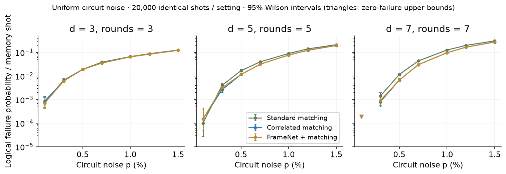
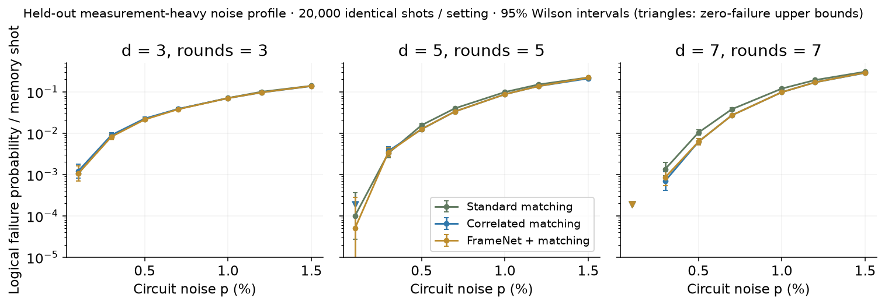
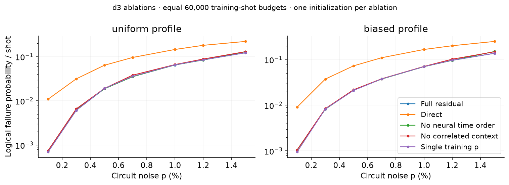
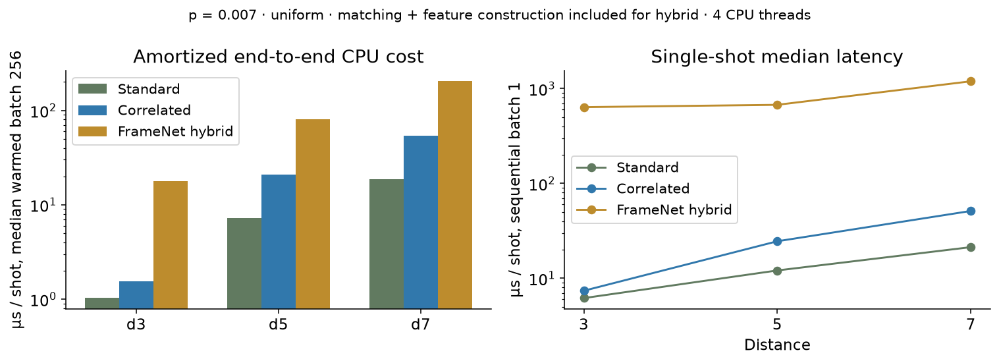

# QubitGuard technical report

CPU-scale neural surface-code decoding study | 25 October 2026

## Result

The compact neural hybrid is genuinely trained and produces verified syndrome-consistent logical-frame corrections. It does not establish an advantage over correlated matching: 0 of 42 primary setting comparisons favor it after correction for the 364 primary sweep comparisons. 2 settings significantly favor correlated matching. The larger full-map follow-up also fails to improve the fresh test mixture. Correlated PyMatching is the recommended decoder for these measured conditions.

## Primary comparison at p=0.007 (uniform)

| Distance | Standard | Correlated | FrameNet s17 |
| --- | --- | --- | --- |
| d3 | 763/20,000 (3.815%) | 705/20,000 (3.525%) | 706/20,000 (3.530%) |
| d5 | 789/20,000 (3.945%) | 626/20,000 (3.130%) | 626/20,000 (3.130%) |
| d7 | 869/20,000 (4.345%) | 603/20,000 (3.015%) | 603/20,000 (3.015%) |

## Circuit and decoder methods

Stim generated rotated surface-code X memories at distances 3, 5 and 7, with rounds equal to distance. Uniform noise sets after-Clifford depolarization, before-round data depolarization, before-measure flips and after-reset flips to the same nominal p. The shifted profile keeps gate p, uses idle p/4 and measurement/reset 2p. This is measurement-heavy channel imbalance, not Pauli-Z-biased noise, leakage or coherent noise. Both matching baselines receive each exact test circuit detector-error model, including decomposed correlation separators. Correlated matching is enabled in both graph construction and inference.

FrameNet reads a two-channel space-time volume: detector bits and a detector-validity mask. Width-8 spatial 1x3x3 convolutions alternate with depthwise temporal 3x1x1 convolutions. A 2x2x2 pooled readout and 48-unit head also receive standard/correlated logical predictions, their disagreement, syndrome density and declared nominal p. The 4,209-parameter model learns true logical flip XOR standard prediction. Its residual bit toggles the standard logical frame. A shortest closed odd-logical graph cycle realizes that toggle without altering any detector parity. These are graphlike DEM recoveries, not unique physical Pauli trajectories.

Each full compact model sees 60,000 retained training shots across p={0.003,0.007,0.012} for 10 epochs; validation uses 8,000 shots at each p. Seeds 17,29,43 vary initialization while sharing training data. AdamW uses learning rate 0.001, weight decay 0.0001, batch 512, float32 and four CPU threads. Class weighting is sqrt(negative/positive), capped at 8. Checkpoint and a grid-searched threshold are selected only on validation failures, with BCE breaking checkpoint ties. Seed17 is the declared primary model; all three initialization seeds are retained. Sigmoid values are uncalibrated class-weighted scores.

| Model | Parameters | Selected epoch | Fit + validation (s) |
| --- | --- | --- | --- |
| Compact d3, seeds 17/29/43 | 4,209 | 10 / 9 / 10 | 32.6 - 444.2 |
| Compact d5, seeds 17/29/43 | 4,209 | 10 / 10 / 1 | 60.0 - 177.7 |
| Compact d7, seeds 17/29/43 | 4,209 | 10 / 10 / 1 | 324.7 - 368.2 |
| Full-map d3, seed 17 | 25,713 | 10 | 176.3 |

## Noise shift and paired evidence

| Distance / profile | Standard failures | Correlated | FrameNet s17 |
| --- | --- | --- | --- |
| d3 / uniform | 6866 | 6631 | 6649 |
| d3 / measurement-heavy | 7579 | 7479 | 7448 |
| d5 / uniform | 10007 | 8780 | 8878 |
| d5 / measurement-heavy | 10550 | 9643 | 9839 |
| d7 / uniform | 13705 | 11455 | 11485 |
| d7 / measurement-heavy | 13307 | 11716 | 11795 |

Each mixture cell covers 140,000 shots over seven equally weighted noise settings; this is descriptive, not a hardware operating rate.

Every primary setting has 20,000 independent held-out shots; all methods decode exactly the same retained vectors. LER is failures per full memory shot, not a fitted per-round rate. Marginal intervals are 95% Wilson. Paired wins/losses identify discordant errors. The exact two-sided paired binomial test is equivalent to exact McNemar on discordances. Global Bonferroni adjustment covers 364 primary comparisons. A conservative paired difference interval subtracts simultaneous Clopper-Pearson win/loss probability bounds, retaining nonzero uncertainty with zero disagreements. These intervals are marginal; simultaneous claims use adjusted p. Absence of significance does not establish equivalence.

| d / profile / p | Neural wins | Neural losses | Delta LER, percentage points | Adjusted p |
| --- | --- | --- | --- | --- |
| d5 / uniform / 0.015 | 43 | 130 | +0.435 | 8.5e-09 |
| d5 / biased / 0.015 | 173 | 373 | +1.000 | 2.6e-15 |

## Ablations

The direct head removes matching predictions and targets true logical flips. The time ablation averages neural inputs over time; matching context still uses the full history. The no-correlation control masks correlated predictions/disagreement. The single-p control uses the same total training/step budget at p=0.007 and mixed-p validation. Its seed is reused with a different sampling shape; exact prefixes differ, so it is not independent training randomness. Controls have one initialization, so small rankings are exploratory. The weak no-correlation and direct results show that much of the hybrid benefit over standard matching comes from access to correlated matching, not demonstrated new syndrome inference.

| d3 model | Uniform failures | Shifted-profile failures |
| --- | --- | --- |
| Standard | 6866 | 7579 |
| Correlated | 6631 | 7479 |
| Compact residual | 6649 | 7448 |
| Direct logical head | 14973 | 16957 |
| No neural time order | 6796 | 7716 |
| No correlated context | 6974 | 7822 |
| Single-p training | 6688 | 7456 |

## Readout revision and independent follow-up

After observing the compact model mostly reproduce correlated matching, a targeted revision replaced 2x2x2 pooling with the full d3 feature map while preserving the encoder, 48-unit head, training shots, optimization steps and seed17. Parameter count rose to 25,713. It selected 971/24,000 validation failures versus compact seed17 968. A new high-bit random-stream namespace produced 280,000 independent d3 test shots across the same 14 settings. The fresh mixture is descriptive, not one physical operating point. The larger model does not improve it and is not promoted to the default demo. This adaptive follow-up is an engineering capacity test, not a preregistered scientific discovery.

| Fresh d3 test / model | Uniform failures | Shifted-profile failures |
| --- | --- | --- |
| Standard | 6688 | 7615 |
| Correlated | 6495 | 7412 |
| Compact residual | 6503 | 7379 |
| Full-map revision | 6525 | 7431 |

## Cost

All inference costs are measured on this Apple arm64 Mac using four PyTorch CPU threads, float32. Batch throughput is median warmed wall time of five batches of 256, divided by 256. Sequential single-shot median and empirical p95 use 32 shots. Hybrid costs include both matching calls, features, grid allocation/tensor conversion and neural inference. Sampling, disk, HTTP, graph construction and certificate construction are excluded. Final timings were refreshed without concurrent QubitGuard fits/tests; OS background load is uncontrolled. The 32-shot tail statistic is not a real-time bound. Fit times include validation but exclude prior data generation/baseline precomputation, and are observational under variable machine load, not a causal architecture speed ranking.

| Distance / decoder | Batch 256 us/shot | Single median us | Observed p95 us |
| --- | --- | --- | --- |
| d3 / standard | 1.03 | 6.2 | 67.1 |
| d3 / correlated | 1.53 | 7.4 | 14.6 |
| d3 / FrameNet | 17.72 | 637.1 | 1378.5 |
| d5 / standard | 7.23 | 12.1 | 21.0 |
| d5 / correlated | 20.83 | 24.6 | 41.1 |
| d5 / FrameNet | 80.67 | 674.0 | 1453.0 |
| d7 / standard | 18.56 | 21.3 | 45.0 |
| d7 / correlated | 53.55 | 51.3 | 124.8 |
| d7 / FrameNet | 203.59 | 1192.9 | 3135.2 |

## Reproducibility and engineering

The delivery retains exact circuits/DEMs, 61 primary NPZ datasets (1,152,000 stored shots including training/validation/control), 14 follow-up test datasets, 14 trained checkpoints, raw held-out predictions, checksums, exact dependency versions and source/config compatibility fingerprints. A full d3 seed17 retraining reproduced every learned tensor, threshold and selected epoch; its recorded checkpoint bytes also matched. Later cache/atomic-storage safeguards do not alter the numerical fitting rule. Initial artifact compatibility metadata was added transparently after full exact circuit, sample, baseline and feature replay. That audit is compatibility evidence, not a retroactive claim of immutable execution provenance. Exact cross-platform replay is not guaranteed.

The full cached CLI run completed training-compatibility checks, held-out evaluation and plot export. Automated contracts cover both bases/all distances, independent graph parity and fault-trace reconstruction, hidden-truth invariance, seeded replay, source/data mutation, incomplete artifacts and concurrent API replay. See verification.json for final execution counts. The CI workflow is supplied but was not executed remotely.

## Interactive demonstration

The local playground exposes lattice/space-time views, detector-time stepping, real noise/distance/profile/basis controls, neural and classical recoveries, explicit logical failures, score provenance and exact benchmark tables. DEM-sampled mechanisms have one representative circuit explanation; they are not uniquely observed physical trajectories. A syndrome certificate and a logical outcome are deliberately separate.

## Limits and unresolved research

No result here establishes a surface-code threshold, universal logical-operation coverage, neural distance transfer, quantum-hardware accuracy, leakage robustness, analog-readout decoding, streaming operation or real-time capability. Neural models support X memory only; the simulator also runs Z memories with explicit unavailable neural output. Unseen noise tests cover selected interpolation/extrapolation and channel imbalance only. The d7 seed29 shifted p=0.015 result is particularly unstable (6,338 failures versus correlated 5,703), despite similar validation performance. Stronger baselines, richer local representations and substantially larger rare-error training sets remain research directions, not proven remedies.

## Relation to NVIDIA and AlphaQubit

Published hardware timing and larger training experiments are contextual references, not reproduced numerical baselines. NVIDIA source and model-weight licenses are separate; gated NVIDIA weights were not downloaded or used. All QubitGuard checkpoints start from random initialization. Convolutional/hybrid decoding is prior art; the original contribution is this implementation, protocol, certificate pipeline, tested readout revision and measured negative/conditional results.

## References

Primary foundations: Bausch et al., Nature 635, 834-840 (2024), doi:10.1038/s41586-024-08148-8; Chamberland et al., arXiv:2604.12841v1 (2026); Gidney, Quantum 5,497 (2021); Higgott and Gidney, Quantum 9,1600 (2025); Fowler, arXiv:1310.0863; Meinerz et al., arXiv:2101.07285v2; Gicev et al., arXiv:2506.16113; Lange et al., arXiv:2610.03869. See research-foundations.md and references.bib for links, prior-art boundaries and separate source/model licenses.
